# Diesel Data scorecard: new guest user

Jira: [DD-5](https://simpledesignllc.atlassian.net/browse/DD-5) · Plan: [End-to-end test plan](https://claude.ai/artifact/VhaxbbdJtdgCatWR3kBU6k) · Run on Nov 1, 2026

**Result: 77/100 overall (C).** Pages average 79 and cross-page features average 75. Two areas fail outright, both from data the user can see:

- **Data consistency (57, F).** One basket shows four different numbers across screens.
- **Offline and errors (54, F).** On the web, switching tabs offline crashes to the error screen.

Paywall (96), relaunch persistence (94) and onboarding (93) are the strongest parts of the app.

## How it was run

- **Build:** `main` at `1f95a72` plus the open DD-4 PR (#57). Web export (`npm run e2e:build`) against the mock server.
- **Browser:** Chromium at 390×844 (2x), cleared storage for every run. Performance runs used 4x CPU throttling, with and without 3G throttling.
- **Guest:** ZIP 74103 (Tulsa, OK, Midwest PADD 2). The starter basket has 16 items.
- **Checks:** all 17 journey steps, axe (WCAG 2.1 AA) on 11 routes, tap-target sizes, offline and backend-down runs, unknown and unmatched links, relaunch.
- **Not testable on the web:** camera barcode scan, receipt scan, haptics, push notifications, native share sheet, Dynamic Type. These are listed at the end for an iOS Simulator pass.

Scoring follows the plan: five areas scored 1 to 5, weighted Function 30%, Data 20%, Clarity 20%, Accessibility 15%, Performance 15%, then scaled to 100. A blocking bug caps the grade at D.

## Scorecard

| Page or feature          |   F |   D |   U |   A |   P | Score | Grade | Blocking bug | Top fix to raise the score                          |
| ------------------------ | --: | --: | --: | --: | --: | ----: | :---: | :----------: | --------------------------------------------------- |
| Onboarding               |   5 |   5 |   4 |   5 |   4 |    93 |   A   |              | Plain-language error when fuel data can't load      |
| Today                    |   5 |   3 |   4 |   3 |   4 |    79 |   C   |              | Chart and basket card agree on the 90-day change    |
| Search                   |   5 |   4 |   4 |   3 |   3 |    80 |   B   |              | 44 pt suggestion chips; survive going offline       |
| Product modal            |   5 |   4 |   4 |   4 |   4 |    86 |   B   |              | Label chart lines; faster unknown-product failure   |
| Item detail and ledger   |   3 |   2 |   4 |   4 |   5 |    69 |   D   |              | Use the same prices as Search and the product modal |
| Basket                   |   4 |   2 |   3 |   2 |   5 |    65 |   D   |              | Rows and totals from the product prices             |
| Log                      |   4 |   4 |   4 |   5 |   5 |    86 |   B   |              | Make the store an explicit choice                   |
| Insights                 |   4 |   3 |   4 |   3 |   4 |    73 |   C   |              | One basket total; alerts off until opted in         |
| Retailer scorecard       |   4 |   2 |   4 |   4 |   5 |    75 |   C   |              | Item counts and grades from the real catalog        |
| Share card               |   1 |   5 |   4 |   4 |   3 |    63 |   D   |   Yes (web)  | Web fallback for Save image and Share               |
| Paywall                  |   5 |   5 |   4 |   5 |   5 |    96 |   A   |              | Ship the Diesel Data rename (#53)                   |
| Error screen             |   4 |   5 |   3 |   4 |   4 |    80 |   B   |              | Branded not-found screen                            |
| Basket sync              |   5 |   3 |   4 |   4 |   5 |    85 |   B   |              | Same total on every screen                          |
| Data consistency         |   3 |   1 |   2 |   4 |   5 |    57 |   F   |              | One price source and one as-of date                 |
| Region by ZIP            |   2 |   5 |   2 |   4 |   5 |    67 |   D   |              | Let people change their ZIP after onboarding        |
| Alerts and notifications |   3 |   4 |   3 |   4 |   4 |    70 |   C   |              | Off by default; ask permission when turned on       |
| Data kept after relaunch |   4 |   5 |   5 |   5 |   5 |    94 |   A   |              | Add an explicit test that the log survives          |
| Offline and errors       |   2 |   4 |   2 |   4 |   2 |    54 |   F   |   Yes (web)  | Keep loaded screens usable offline; add retry       |
| Accessibility overall    |   4 |   5 |   4 |   3 |   5 |    84 |   B   |              | 44 pt tap targets on segmented controls             |
| Performance overall      |   5 |   5 |   3 |   5 |   3 |    86 |   B   |              | Compress and split the 3.5 MB web bundle            |

F = Function, D = Data correctness, U = Clarity and UX, A = Accessibility, P = Performance and resilience.

## Top 10 fixes

Ranked by points gained for the effort. Each one can become its own DD ticket.

| #   | Fix                                                                                                                                                                     | Effort | Raises                                                      |
| --- | ----------------------------------------------------------------------------------------------------------------------------------------------------------------------- | :----: | ----------------------------------------------------------- |
| 1   | Drive Basket rows, item detail, verdicts and the Delta chart from the product prices (`getProducts`), not the older item fixtures (`getItem`).                          |   L    | Data consistency, Basket, Item detail, Insights, Basket sync |
| 2   | Anchor every "today" and window on one as-of date and print it. Today's chart ends Oct 26 and the basket card ends today, so "90D" reads +1.8% and +2.2% on one screen. |   S    | Today, Data consistency                                     |
| 3   | Keep loaded screens working offline on the web: preload the tab route chunks (or turn off async routes for tabs), and add a Retry button to every load error.          |   M    | Offline and errors, Search                                  |
| 4   | Web fallback for the share card: download the PNG on Save image, and use `navigator.share` with a copy-link fallback for Share.                                         |   M    | Share card                                                  |
| 5   | Add a Location row (Insights or a settings sheet) that reopens the ZIP step without clearing the basket.                                                               |   S    | Region by ZIP                                               |
| 6   | Start all break alerts off. Ask for notification permission the first time one is turned on.                                                                           |   S    | Alerts and notifications                                    |
| 7   | Raise segmented controls, chips and the movers pause button to 44 pt. The Basket range chips are 24 pt tall.                                                            |   S    | Accessibility, Basket, Today, Search, Insights              |
| 8   | Compute the retailer scorecard from the tracked catalog. It claims 418 Walmart items while the catalog has 150 products.                                               |   M    | Retailer scorecard, Data consistency                        |
| 9   | Undo on basket removal, and one range set (30D, 90D, 1Y) everywhere. Basket uses 90D, 6M, 1Y.                                                                          |   S    | Basket                                                      |
| 10  | Replace raw errors with plain words ("TypeError: Failed to fetch" on onboarding), and add a branded not-found screen in place of Expo's "Unmatched Route / Sitemap".   |   S    | Onboarding, Error screen, Offline and errors                |

Merging #53 (the Diesel Data rename) also clears the old "DieselDelta" name that still shows on onboarding, Insights, the paywall and the share card.

## Findings by page

### Onboarding: 93 (A)

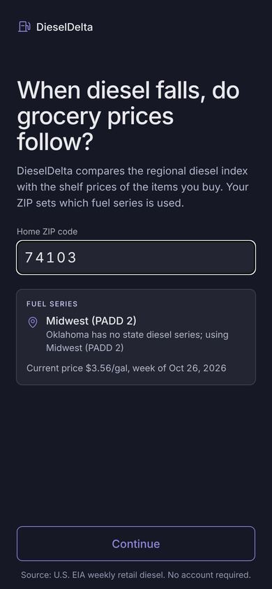

- **Works:** redirects a fresh install straight to onboarding. Validation is clear ("Enter a 5-digit US ZIP code", "covers ZIP codes in the 50 states and DC"), letters are stripped, and the keyboard is numeric. Valid ZIPs preview the fuel series and current price before Continue.
- **Issues:**
    - With the backend down, the error reads "Fuel prices could not be loaded: TypeError: Failed to fetch" ([screenshot](shots/backend-down-onboarding.jpg)).
    - Still branded "DieselDelta" until #53 merges.
    - Cold start to the ZIP field is 2.6 s at 4x CPU and 22 s on throttled 3G (web only).
- **To raise the score:** a plain-language error with Retry (U 4→5, S). Compress the web bundle (P 4→5, M).

### Today: 79 (C)

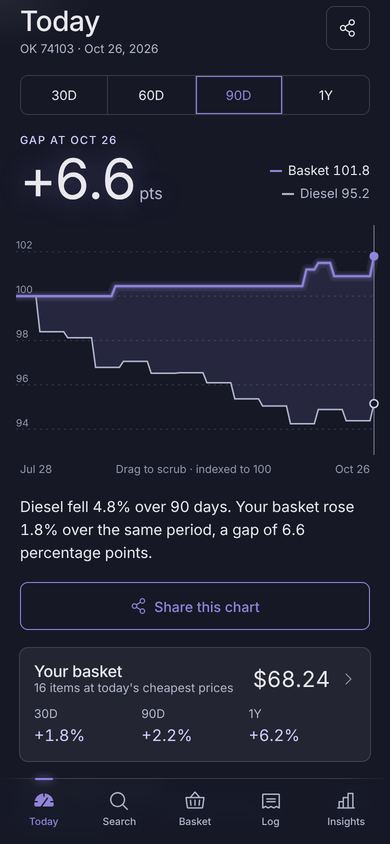

- **Works:** the Delta chart scrubs. The basket card follows Search changes at once. The movers list shows 9 products, reshuffles every 60 s, and the pause button stops rotation.
- **Issues:**
    - The chart says the basket "rose 1.8% over 90 days". The basket card right below says 90D +2.2%. The chart ends on the diesel week (Oct 26); the card uses today's prices.
    - With the backend down, the chart shows "Prices could not be loaded" with no Retry button.
    - Window buttons are 38 pt tall, and the pause button is 36 pt.
- **To raise the score:** one as-of date (D 3→5, S). 44 pt controls (A 3→4, S). Retry on error (P 4→5, S).

### Search: 80 (B)

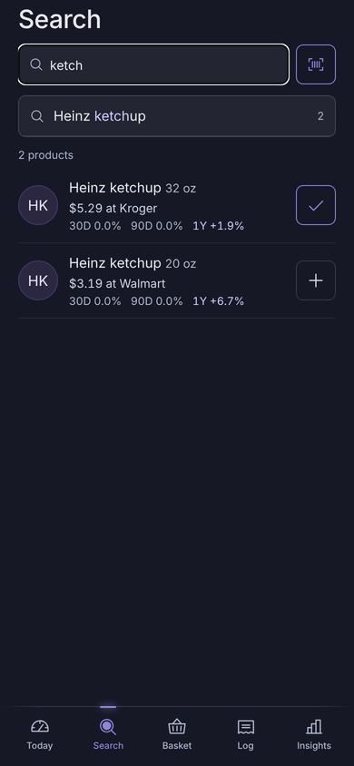

- **Works:**
    - "ketch" suggests "Heinz ketchup, 2 products", and picking it runs the search.
    - Results load 20 at a time and end at "Showing all 150" ([screenshot](shots/search-end.jpg)).
    - An empty query reads "No tracked item matches …".
    - + and ✓ update the Basket tab at once.
- **Issues:**
    - Suggestion and quick-search chips are 34 pt tall.
    - Opening Search after going offline lands on "Something went wrong" (web: the tab's code chunk can't load).
- **To raise the score:** 44 pt chips (A 3→4, S). Preloaded tab chunks (P 3→4, M).

### Product modal: 86 (B)

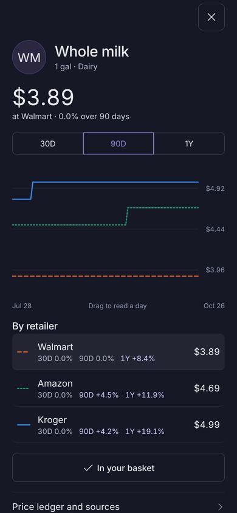

- **Works:** opens in 0.4 s. 30D/90D/1Y ranges, one line per retailer, drag to read a day, tap a retailer to make it the headline, and add to basket.
- **Issues:**
    - Chart lines are identified only by the legend in the rows below.
    - The cheapest line (Walmart $3.89) sits below the lowest axis label ($3.96).
    - An unknown product shows "Loading…" for several seconds before "This product could not be loaded."
- **To raise the score:** label the line ends (U 4→5, S). Fail fast on unknown ids (P 4→5, S).

### Item detail and ledger: 69 (D)

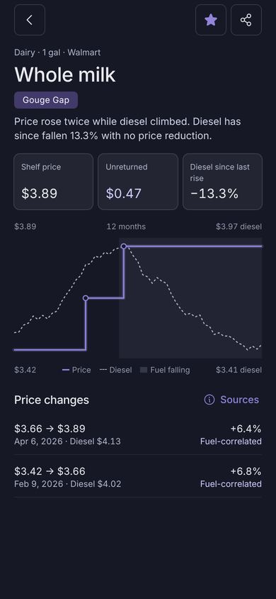

- **Works:** the verdict, unreturned amount, fuel overlay, ledger and data sources panel all render. The sources panel shows capture time, method and confidence.
- **Issues:**
    - Whole milk is $3.42 → $3.89 over 12 months here (Gouge Gap). The product modal says Walmart 1Y +8.4%. The two screens read different price data.
    - "Report a correction" opens a toast: "Corrections open in a later update".
- **To raise the score:** fix #1 (D 2→5, L). Hide the correction button until it works, or ship it (F 3→4, S to M).

### Basket: 65 (D)

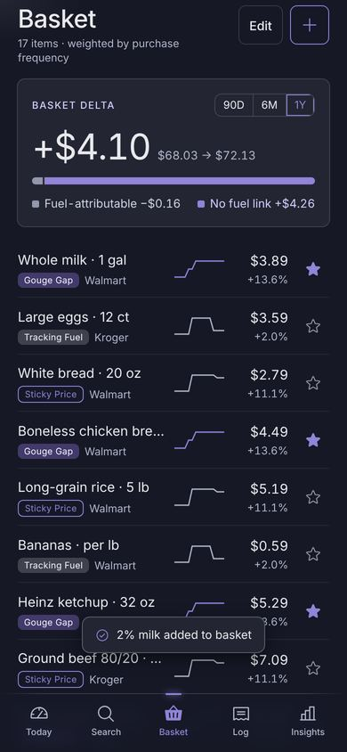

- **Works:** 17 items after adding one from Search. Edit removes items. Follow and unfollow work. + opens Search.
- **Issues:**
    - Rows show +13.6% for milk, chicken and ketchup alike, from the older item data, while Search shows +8.4% for milk.
    - The 90-day Basket Delta ends at $67.94. The Today card says $68.24.
    - The range chips are 90D, 6M and 1Y here but 30D, 90D and 1Y everywhere else.
    - Range chips are 24 pt tall.
    - There is no undo after removing an item.
    - The "added" toast covers rows.
- **To raise the score:** fix #1 (D 2→5, L). 44 pt chips (A 2→4, S). Undo and a consistent range set (U 3→4, S).

### Log: 86 (B)

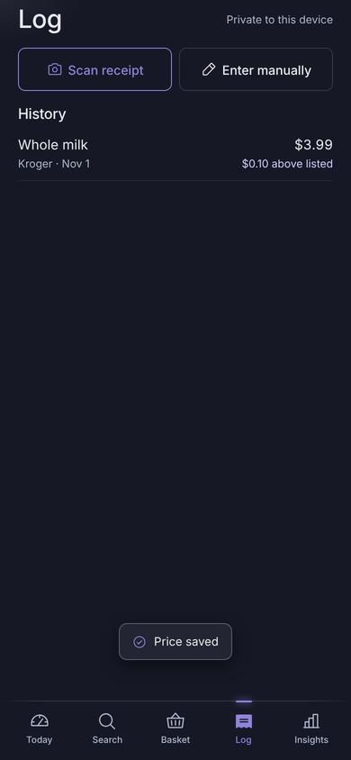

- **Works:** manual entry with suggestions. Saving empty shows "Enter a price above $0". The price field drops letters and minus signs. A saved entry compares with the listed price ("$0.10 above listed").
- **Issues:**
    - The store defaults to Kroger without the user choosing it.
    - Receipt scan is native only (untested).
- **To raise the score:** no default store, or remember the last one used (F 4→5, S).

### Insights: 73 (C)

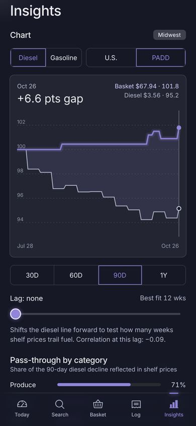

- **Works:** the chart explorer is at the top (DD-1). Fuel and scope toggles, the lag slider with best fit, pass-through by category, the region table, the methodology sheet and the alert toggles all respond.
- **Issues:**
    - The chart header shows "Basket $67.94", while Today shows $68.24.
    - All three alerts are on for a guest who never asked for them.
    - The window selector is under the chart here but above it on Today.
    - Segmented controls are 36–38 pt.
    - The console shows two Reanimated layout-animation warnings.
- **To raise the score:** fixes #1 and #2 (D 3→5). Alerts off by default (F 4→5, S). 44 pt controls (A 3→4, S).

### Retailer scorecard: 75 (C)

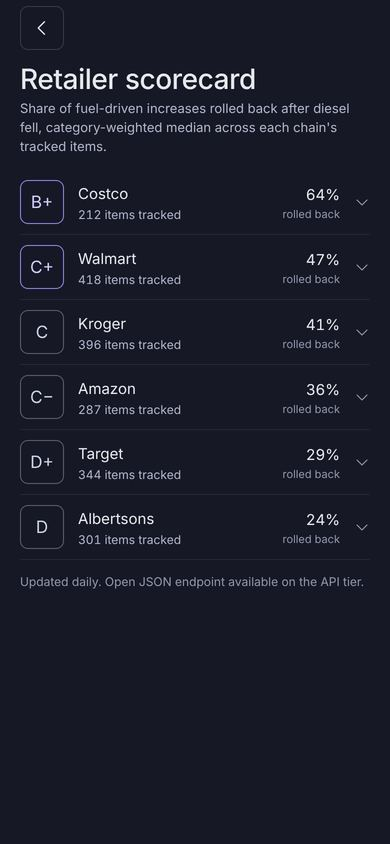

- **Works:** grades and percentages are clear, and each row expands to a category breakdown.
- **Issues:**
    - Item counts (Walmart 418, Kroger 396) exceed the 150-product catalog. The figures are prototype constants.
    - There is no sorting.
- **To raise the score:** compute it from the catalog (D 2→4, M).

### Share card: 63 (D, blocking on the web)

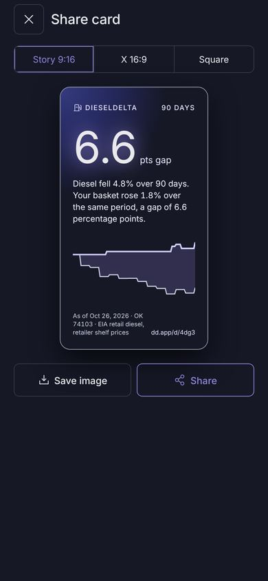

- **Works:** the card is accurate, with an as-of date, ZIP, sources and a short link. The three formats switch.
- **Issues:**
    - On the web, **Save image does nothing**: no download and no message.
    - **Share shows "Could not create the image"** (expo-sharing and file APIs aren't available on the web).
    - Native behavior is untested.
- **To raise the score:** fix #4 (F 1→4, M). Retest on iOS.

### Paywall: 96 (A)

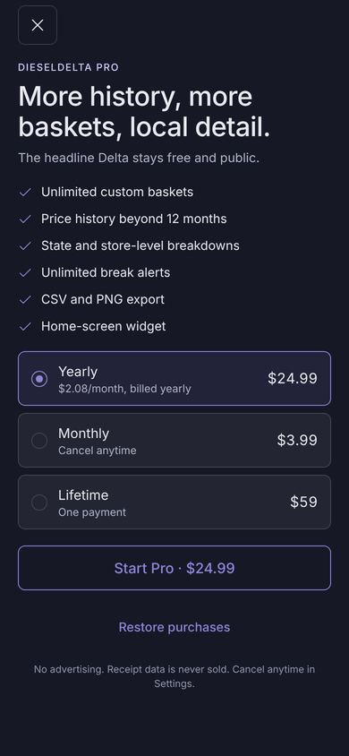

- **Works:** three plans as radios, and the button price follows the chosen plan ("Start Pro · $3.99"). Unlocking returns to Today with "Pro unlocked", and Pro survives a relaunch. Close and Restore are present.
- **Issues:** "DIESELDELTA PRO" until #53 merges. Restore was not exercised against a real store.

### Error screen: 80 (B)

- **Works:**
    - Render errors land on "Something went wrong" with Try again ([screenshot](shots/offline-search.jpg)).
    - An unknown item says "This item is not tracked." ([screenshot](shots/unknown-item.jpg)).
- **Issues:**
    - An unmatched URL shows Expo's default "Unmatched Route" page with a "Sitemap" link ([screenshot](shots/not-found.jpg)).
    - The unknown-item screen is a single line with a back button, and no path to Search.
- **To raise the score:** add `+not-found.tsx` with the app's styling and a Home button (U 3→5, S).

## Findings by feature

- **Basket sync: 85 (B).** Adding or removing in Search updates Basket and Today at once. The totals they show disagree (see Data consistency).
- **Data consistency: 57 (F).**
    - **One basket, four numbers:** Today's card says $68.24. The Today chart and the Basket Delta use $67.94. Basket rows use per-item changes from a different dataset.
    - **Two price pipelines:** `getProducts` (Search, product modal, Today card, movers) and `getItem` (Basket rows, item detail, verdicts).
    - **Two end dates:** the diesel week (Oct 26) and today.
    - **Retailer counts:** the scorecard's item counts don't match the catalog.
- **Region by ZIP: 67 (D).** The ZIP correctly picks the series ("Oklahoma has no state diesel series; using Midwest (PADD 2)"). There is no way to change it after onboarding short of clearing app data.
- **Alerts and notifications: 70 (C).** The toggles and tolerance stepper work. Alerts start on before any permission request. Push delivery can't be tested on the web.
- **Data kept after relaunch: 94 (A).** ZIP, basket, follows, alerts and Pro all survive a reload (`dd.prefs`, `dd.alerts` and `dd.query-cache` in storage). Onboarding doesn't reappear. The log wasn't checked separately after relaunch.
- **Offline and errors: 54 (F, blocking on the web).** Going offline, then opening a tab not yet visited, crashes to the error screen. Backend-down states show messages but no Retry button. Grocery data still shows offline because it is bundled.
- **Accessibility overall: 84 (B).**
    - **axe (WCAG 2.1 AA):** no violations except `label-content-name-mismatch`, which the repo's a11y spec already documents as a react-native-web false positive.
    - **Tap targets:** at least 34 visible controls across 7 screens are under 44 pt.
    - **Text scaling and reduce-motion:** no code handles text scaling, so Dynamic Type at 200% needs a device check. Reduce-motion relies on Reanimated's system default.
- **Performance overall: 86 (B).**
    - **Navigation:** screen to screen takes 0.4–1.4 s at 4x CPU.
    - **Bundle:** 3.5 MB uncompressed (the test server doesn't gzip).
    - **Cold start:** 2.6 s at 4x CPU, 22 s on 3G.
    - **Scrolling:** the 150-product list produces long tasks of up to about 180 ms.
    - Native builds load from the device, so the bundle numbers apply to the web only.

## Retest on the iOS Simulator

- **Native-only features:** camera barcode scan on Search, receipt scan on Log, haptics while dragging charts.
- **Notifications and sharing:** the permission prompt and alert delivery, and the share sheet with Save to Photos (the share card is broken on the web, so native decides its grade).
- **Display settings:** Dynamic Type at the largest sizes on Today, Basket and the product modal, and VoiceOver through the whole journey.
- **Persistence:** cold start, plus the log after the app is killed.
